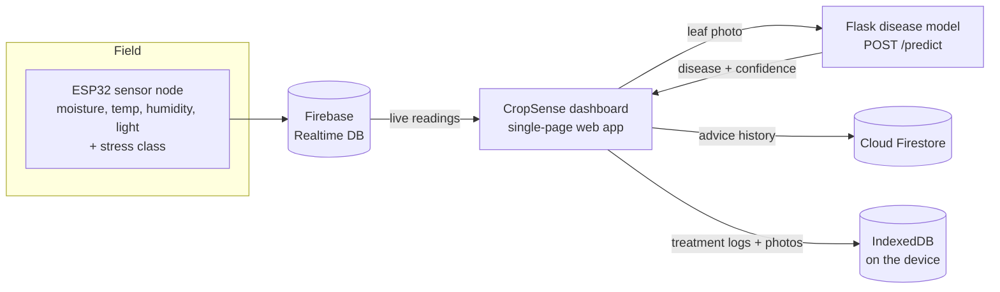

<picture>
  <source media="(prefers-color-scheme: dark)" srcset=".github/assets/header-dark.svg">
  
</picture>

<picture>
  <source media="(prefers-color-scheme: dark)" srcset=".github/assets/stats-dark.svg">
  
</picture>

<br>

## 01 &nbsp; Why this exists

A farmer notices spots on his tomato leaves. Is it early blight? Too much water? Not enough sun? The agronomist is far away, most farm apps are in English, and a wrong guess costs a week of crop and money spent on the wrong spray.

## 02 &nbsp; A day with CropSense

The dashboard is designed around one person: *Ramesh*, who grows tomatoes on Plot A.

| Moment | What happens |
|---|---|
| **Morning** | He opens the app in Kannada. Moisture, temperature, humidity and light come in live from the ESP32 node in his field. |
| **An alert** | Moisture is 28%. The app doesn't show a red number, it says *water in the morning*. |
| **A photo** | He photographs a spotted leaf. The disease model returns *early blight* with a confidence score, and the advice changes to match. |
| **What to buy** | Treatments with where to buy them and how to use them, plus a weekly cost estimate he can share on WhatsApp. |
| **A week later** | He logs whether it worked, adds an "after" photo, and sees the trend and a before/after comparison. |

## 03 &nbsp; How it's built



## 04 &nbsp; Decisions I'd defend in an interview

- **It works when the model doesn't.** If the model server is unreachable, CropSense falls back to the stress class computed on the ESP32 and still gives advice. Rural internet is unreliable, so this wasn't optional.
- **From `localStorage` to IndexedDB, without losing anyone's history.** Photo logs quickly hit `localStorage`'s ~5 MB limit, so I moved them to IndexedDB and wrote a one-time migration for existing data.
- **The bug I'm proudest of finding.** Saving hung on *Saving…* forever. Firebase functions imported inside an ES module weren't visible to the classic script, which threw a silent `ReferenceError`. I traced it and exposed them on `window`.
- **No build step.** One HTML file and Firebase from the CDN, so it runs anywhere a browser does.

## 05 &nbsp; Details I obsessed over

- **Five scripts, five proper typefaces.** Noto Sans Devanagari, Kannada, Tamil and Telugu, paired with Plus Jakarta Sans and Sora, so no language looks like an afterthought.
- **Every string is translatable.** 115 `data-i18n` keys, with a lookup that falls back to English rather than showing a blank.
- **Product cards in his language too.** Not just the menus: where to buy and how to use are translated as well.
- **Separate mobile navigation.** A dedicated bottom bar with short labels, because farmers use phones, not laptops.

## 06 &nbsp; Run it

```bash
git clone https://github.com/Stanvi09/CropSense.git && cd CropSense
python -m http.server 8000          # open http://localhost:8000
```

To use your own backend, put your Firebase web config in the `firebaseConfig` block in `index.html` and set `window._modelAPIUrl` to your model server. It should accept a multipart `image` at `POST /predict` and return `{ raw_label, confidence }`, where `raw_label` is a PlantVillage class such as `Tomato_Early_blight`.

## 07 &nbsp; Next

- Add the model-training notebook and Flask server to this repo
- Split `index.html` into `css/`, `js/` and `i18n/`
- Offline mode with a service worker
- Read the advice aloud, for farmers who prefer listening

<br>

<picture>
  <source media="(prefers-color-scheme: dark)" srcset=".github/assets/footer-dark.svg">
  
</picture>

<p align="center"><sub><a href="https://www.linkedin.com/in/tanvi-sadashiv-3713ba381">LinkedIn</a> &nbsp;&middot;&nbsp; <a href="https://github.com/Stanvi09">GitHub</a></sub></p>
